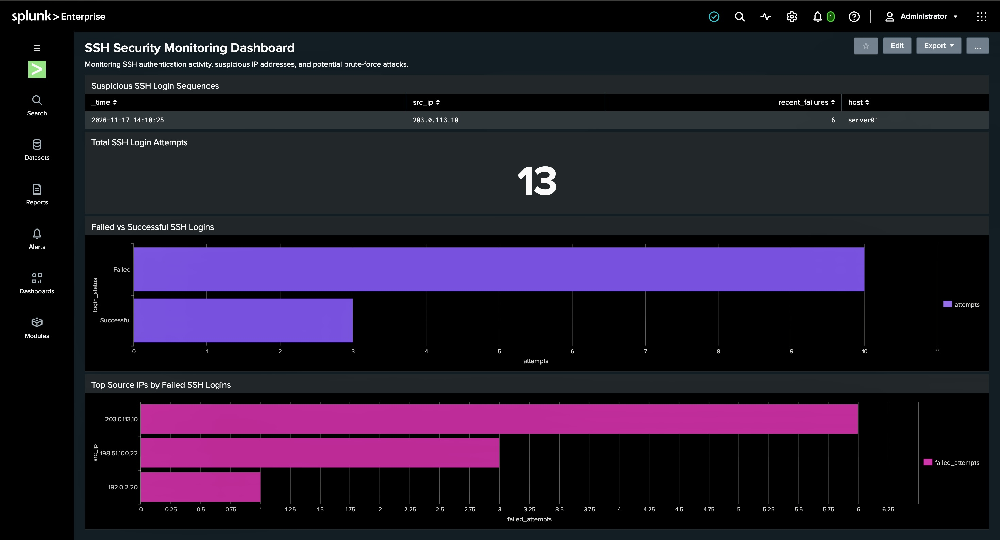
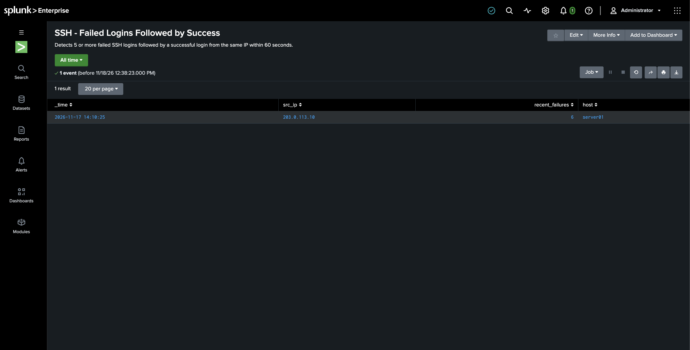
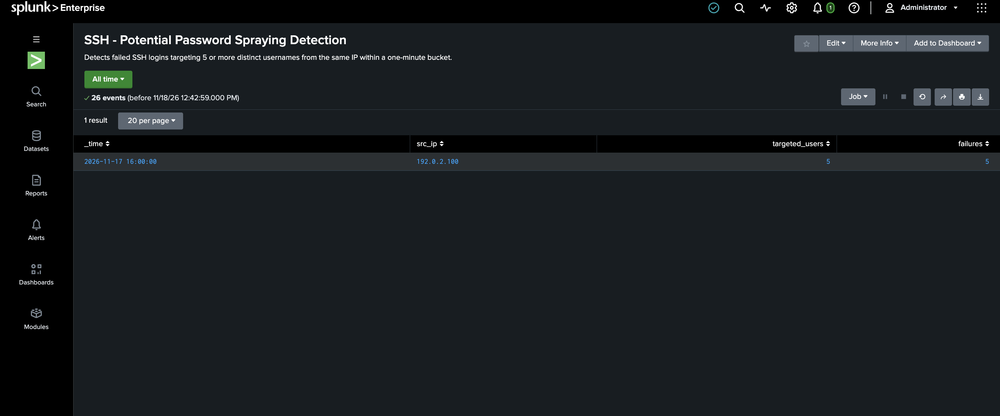

# SSH Threat Detection and Incident Investigation Using Splunk

## Project Overview

This project demonstrates how Splunk Enterprise can be used to monitor Linux SSH authentication activity, investigate suspicious login attempts, and develop detection rules for potential brute-force and password-spraying behavior.

I built a local security monitoring lab using simulated SSH authentication logs and created a Splunk dashboard to visualize authentication patterns.

## Tools and Technologies

- Splunk Enterprise
- Splunk Search Processing Language (SPL)
- Python
- macOS Terminal
- Linux SSH authentication log format

## Project Objectives

- Analyze SSH authentication logs.
- Detect repeated failed login attempts.
- Identify successful logins following multiple failures.
- Investigate possible password-spraying activity.
- Evaluate and improve detection rules.
- Build a security monitoring dashboard.

## Dataset

Two Splunk indexes were used:

| Index | Events | Purpose |
|---|---:|---|
| `ssh_lab` | 13 | Initial investigation and dashboard |
| `ssh_testing` | 49 | Detection validation and testing |

All events were simulated for educational purposes. No real systems were attacked.

## Security Monitoring Dashboard

The dashboard contains four panels:

1. Total SSH Login Attempts
2. Failed vs. Successful SSH Logins
3. Top Source IPs by Failed Logins
4. Suspicious SSH Login Sequences

## Detection Rules

### Rule 1: Failed Logins Followed by Success — IP Only

Detects five or more failed SSH logins followed by a successful login from the same IP within 60 seconds.

[View SPL Query](detection-rules/ssh_failed_then_success_ip.spl)

### Rule 2: Failed Logins Followed by Success — IP and Username

Improves detection by grouping authentication attempts by both source IP and username.

[View SPL Query](detection-rules/ssh_failed_then_success_user.spl)

### Rule 3: Potential Password Spraying

Identifies IP addresses targeting at least five distinct usernames with failed SSH attempts within a fixed one-minute time bucket.

[View SPL Query](detection-rules/ssh_password_spraying.spl)

## Investigation Findings

- Identified six failed SSH login attempts followed by successful authentication.
- Compared IP-only and IP-plus-username detection approaches.
- Evaluated a shared-IP scenario that could produce a false positive in the IP-only rule.
- Identified a simulated password-spraying pattern involving five distinct usernames.

## Detection Evidence

### Failed Logins Followed by Success

### Potential Password Spraying

## Incident Investigation Report

[Read the Investigation Report](reports/SSH_Incident_Investigation_Report.pdf)

## Limitations and Future Improvements

- All authentication events are simulated.
- Detection thresholds require validation against real organizational baselines.
- Shared IP addresses can cause false positives.
- Fixed one-minute time buckets may miss activity crossing bucket boundaries.
- Future improvements could include additional authentication patterns, more realistic datasets, and scheduled alerting.

## Key Skills Demonstrated

Splunk Enterprise, SIEM monitoring, log analysis, SPL queries, threat detection, detection validation, Python, and incident investigation.

